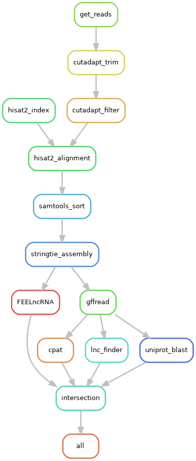

# 🧬 lncRNA-Workflow

**A modular and reproducible Snakemake pipeline for identification and analysis of lncRNAs from RNA-seq data.**

This pipeline is designed to start directly from **SRA accession IDs** and automate the full process of identifying both known and novel **long non-coding RNAs (lncRNAs)** using a set of standard and powerful tools. It’s ideal for beginners who want a reproducible way to analyze RNA-seq data with minimal setup.

---

## 🧾 Table of Contents

- [Overview](#overview)
- [Workflow Summary](#workflow-summary)
- [Requirements](#requirements)
- [Installation](#installation)
- [How to Use](#how-to-use)
- [Docker Installation](#docker-installation)
- [Output](#output)
- [Minimal End-to-End Example](#minimal-end-to-end-example)
- [Visualization](#visualization)
- [Credits](#credits)

---

## 📖 Overview

lncRNAs (long non-coding RNAs) are transcripts longer than 200 nucleotides that do not encode proteins but are involved in regulating gene expression, chromatin organization, and other cellular processes. 

This workflow provides a comprehensive method to:
- Download RNA-seq data from NCBI SRA
- Preprocess and align reads
- Assemble transcripts
- Apply multiple coding potential filters
- Identify high-confidence lncRNAs

---

## 🔁 Workflow Summary

The figure below shows the structure of the pipeline:



### Key Steps:

1. **get_reads** – Automatically downloads RNA-seq datasets using SRA IDs (via `fastq-dump` or `prefetch`).
2. **cutadapt_trim & cutadapt_filter** – Removes adapter sequences and filters low-quality reads.
3. **hisat2_index** – Builds genome index from the reference genome.
4. **hisat2_alignment** – Aligns reads to the reference genome.
5. **samtools_sort** – Sorts aligned reads for assembly.
6. **stringtie_assembly** – Assembles transcripts from the aligned reads.
7. **gffread** – Processes the GTF file for compatibility.
8. **FEELncRNA, CPAT, lnc_finder** – Apply multiple tools to identify lncRNAs based on coding potential.
9. **uniprot_blast** – Removes known protein-coding transcripts.
10. **intersection** – Combines filtered results from all tools to identify high-confidence lncRNAs.
11. **all** – Final results.

---

## 💻 Requirements

- **Snakemake ≥ 7.0**
- **Python ≥ 3.6**
- **Conda** (recommended)

### Required Tools (installed automatically via Conda environments):
- `sra-tools` (for `fastq-dump`)
- `cutadapt`
- `hisat2`
- `samtools`
- `stringtie`
- `gffread`
- `CPAT`
- `FEELnc`
- `BLAST+`

Software dependencies are managed through the Conda environment files provided in the repository. External model files and training sequences must also be available where required.

---

## Installation

Clone the repository:

```bash
git clone https://github.com/bigfacilityiisr/lncRNA-Workflow.git
cd lncRNA-Workflow
```

## How to Use

### 1. Configure the workflow

Before running LncSnake, edit `config/config.yml` to specify the input samples, reference genome, and annotation files.

The `sample_table` field must point to a tab-separated sample metadata file containing an `SRA_ID` column. Each row should correspond to an RNA-seq sample to be processed.

The reference genome and annotation must be provided using the nested reference and annotation fields expected by the configuration file. Update all paths to match the files available in your working directory.

Refer to the example configuration and sample table included in the repository for the required structure.

### 2. Run the workflow

First, perform a dry run to check the configuration and workflow dependencies:

```bash
snakemake --snakefile Snakefile \
    --configfile config/config.yml \
    --cores 4 --use-conda -n
```

If the dry run completes successfully, execute the workflow:

```bash
snakemake --snakefile Snakefile \
    --configfile config/config.yml \
    --cores 4 --use-conda
```

The first execution may take longer because Snakemake must download input data and create the required Conda environments.

## Docker Installation

LncSnake includes a Dockerfile to simplify software installation and dependency management.

Build the Docker image from the repository root:

```bash
git clone https://github.com/bigfacilityiisr/lncRNA-Workflow.git
cd lncRNA-Workflow
docker build -t lncsnake:latest .
```

Check the workflow using a dry run:

```bash
docker run --rm \
    -v "$PWD:/opt/lncRNA-Workflow" \
    -w /opt/lncRNA-Workflow \
    lncsnake:latest \
    snakemake --snakefile Snakefile \
    --configfile config/config.yml \
    --cores 4 --use-conda -n
```

If you use Docker to execute the workflow, ensure that the configuration, input files, reference files, and required model resources are accessible inside the container. Configure persistent output directories so that results remain available on the host.

The Dockerfile and the repository documentation should be kept synchronized as the workflow changes.

## Output
You’ll get the following:

✅ Assembled transcripts (.gtf)

✅ Output from FEELnc, CPAT, lncFinder

✅ BLAST results against UniProt

✅ Filtered intersection of predictions

✅ Final consensus set of lncRNAs

✅ Log files for each rule

## Visualization
To visualize the entire workflow as a DAG (Directed Acyclic Graph):

snakemake --dag | dot -Tpng > rulegraph.png
This will generate a graphical representation of how the steps depend on each other.

## Minimal End-to-End Example

This test demonstrates how to configure and execute LncSnake for a single RNA-seq sample. It covers read retrieval, preprocessing, alignment, transcript assembly, lncRNA identification, protein-homology filtering, and generation of the final consensus candidate list.

### 1. Prepare the test configuration

Create a test sample table named `config/test_sample.tsv`:

```tsv
SRA_ID	BioProject	BioSample	LibraryLayout	tissue
SRR22201559	PRJNA898683	SAMN31621251	PAIRED	Root
```

Create a separate configuration file named `config/test_config.yml`:

```yaml
sample_table: "config/test_sample.tsv"

reference:
  ftp: "https://ftp.ncbi.nlm.nih.gov/genomes/all/GCF/018/446/385/GCF_018446385.1_Zo_v1.1/GCF_018446385.1_Zo_v1.1_genomic.fna.gz"
  fasta: "data/GCF_018446385.1_Zo_v1.1_genomic.fasta"

annotation:
  ftp: "https://ftp.ncbi.nlm.nih.gov/genomes/all/GCF/018/446/385/GCF_018446385.1_Zo_v1.1/GCF_018446385.1_Zo_v1.1_genomic.gtf.gz"
  gtf: "data/GCF_018446385.1_Zo_v1.1_genomic.gtf"

cutadapt:
  overlap: 5
  min_length: 30

star:
  sjdbOverhang: 100
```

This configuration uses the ginger reference genome and annotation specified in the main configuration, while restricting the workflow to one sample.

### 2. Prepare the required model files

Before running the workflow, ensure that the following files are available:

**CPAT resources**
- `others/Model/Plant_Hexamer.tsv`
- `others/Model/Plant.logit.RData`

**LncFinder resources**
- `others/Model/Plant_model.rda`
- `others/example_data/training_mRNA.fasta`
- `others/example_data/training_lncRNA.fasta`

These files are required by the CPAT and LncFinder rules. They are supplied within the repository. 

### 3. Perform a dry run

From the repository root, execute:

```bash
snakemake \
    --snakefile Snakefile \
    --configfile config/test_config.yml \
    --cores 2 \
    --use-conda \
    --dry-run
```

The dry run checks workflow configuration, rule dependencies, and the planned jobs without executing the analysis.

### 4. Execute the test

If the dry run succeeds and all required input resources are available, run:

```bash
snakemake \
    --snakefile Snakefile \
    --configfile config/test_config.yml \
    --cores 2 \
    --use-conda
```

Snakemake will execute the workflow for the selected sample and create the required software environments as needed.

### 5. Verify the results

The expected final output is:

```text
output/intersection/SRR22201559_lncRNAs.txt
```

Additional intermediate results should be generated in the corresponding output directories, including:

- `output/transcripts/` — reconstructed transcript sequences.
- `output/lncRNA/FEELnc/` — FEELnc results.
- `output/lncRNA/cpat/` — CPAT results.
- `output/lncRNA/lncFinder/` — LncFinder results.
- `output/uniprot/` — protein-homology search results.
- `logs/` — execution logs for individual rules.

Confirm that the final consensus file exists and is non-empty, inspect the rule-specific logs for errors, and verify that the expected intermediate outputs were generated.

## Credits
This pipeline was developed as part of a Ginger lncRNA discovery project carried out by the Bioinformatics and Integrative Genomics (BIG) Facility,
ICAR-Indian Institute of Spices Research, Kozhikode.

The work was conducted under the National Network Project on Crop Bioinformatics:NNP of NIPGR, New Delhi.

It integrates tools like FEELnc, CPAT, lncFinder, and BLAST+ into a reproducible and modular Snakemake workflow for effective discovery and characterization of long non-coding RNAs in plants.

## Contact
If you have any issues, suggestions, oSoftware dependencies are managed through the Conda environment files provided in the repository. External model files and training sequences must also be available where required.r need help, please:

Raise an issue on the GitHub repository

Email us at: bigfacilityiisr@gmail.com
